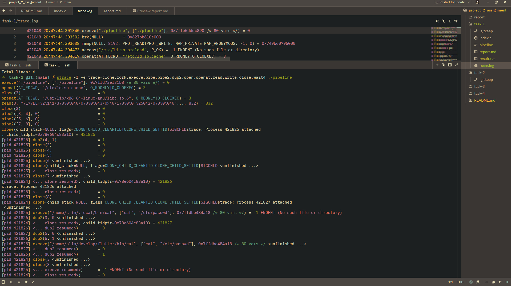

# Task 1 — Three-stage command pipeline

## Pipeline design

The C program implements the following pipeline with three child processes.

```sh
cat /etc/passwd | cut -d: -f7 | sort -u
```

`cat` reads `/etc/passwd`. `cut` extracts the seventh colon-separated field, which contains the login shell. `sort -u` sorts the shell paths and removes duplicates. The parent captures the full output in `result.txt`, reports each child's exit status, and reopens the file to display up to five lines and the total line count.

## Running the trace

I compiled the program and ran both trace commands from `task-1`.

```sh
gcc index.c -o pipeline
strace -f -tt -o trace.log ./pipeline
strace -f -e trace=clone,fork,execve,pipe,pipe2,dup2,open,openat,read,write,close,wait4 ./pipeline
```

`-f` follows the children. The first trace command uses `-tt` to add timestamps and `-o trace.log` to save the trace. The second runs the program again and displays only the selected system calls in the terminal. The screenshot shows the filtered run. The excerpts below come from the timestamped run, so they have different PIDs.



## Process creation

The parent calls `fork()` once for each stage after creating the pipes. `fork()` returns the child's PID to the parent and `0` in the child. In this run, the calls appear as `clone()`. The excerpt shortens the argument lists.

```text
421048 20:47:44.307856 clone(...) = 421051
421048 20:47:44.308092 clone(...) = 421052
421048 20:47:44.308288 clone(...) = 421053
```

The parent is PID `421048`. The child PIDs are `421051` for `cat`, `421052` for `cut`, and `421053` for `sort`. After setting up its descriptors, each child calls `execvp()`. This searches `PATH` and attempts `execve()` on candidate paths. The `ENOENT` entries show candidates where the executable was absent. Each command eventually starts from `/usr/bin`.

For example, the successful `execve()` for `sort` appears in two parts because the tracer reports events from multiple processes.

```text
421053 20:47:44.311544 execve("/usr/bin/sort", ["sort", "-u"], 0x7ffc3b97f4d8 /* 80 vars */ <unfinished ...>
421053 20:47:44.312125 <... execve resumed>) = 0
```

A successful `execve()` replaces the child’s program while preserving its PID and the redirected standard descriptors.

## Pipe setup and redirection

The three `pipe()` calls appear as `pipe2()` with flags `0`. Each returned pair contains the read descriptor first and the write descriptor second.

```text
421048 20:47:44.307638 pipe2([3, 4], 0) = 0
421048 20:47:44.307692 pipe2([5, 6], 0) = 0
421048 20:47:44.307747 pipe2([7, 8], 0) = 0
```

Each child inherits all six descriptors. It uses `dup2()` to make standard input (FD `0`) or standard output (FD `1`) refer to the appropriate pipe end.

| Process | Input | Output |
| --- | --- | --- |
| `cat` | Opens `/etc/passwd` using the filename argument | `dup2(4, 1)` sends standard output to pipe 1 |
| `cut` | `dup2(3, 0)` reads from pipe 1 | `dup2(6, 1)` sends standard output to pipe 2 |
| `sort` | `dup2(5, 0)` reads from pipe 2 | `dup2(8, 1)` sends standard output to pipe 3 |
| Parent | Reads pipe 3 directly through FD `7` | Writes the captured bytes to `result.txt` |

After `dup2()`, each child closes the six original descriptors. The standard descriptors created by the redirections still refer to the required pipe ends. The parent closes every pipe descriptor except FD `7`, including its own copy of the final write end.

```text
421048 20:47:44.308559 close(8)         = 0
```

A pipe read returns `0` when the pipe is empty and every descriptor referring to its write end has been closed. If the parent kept FD `8` open, its own read could block after `sort` exited. The same issue applies to the earlier pipes if an unrelated process keeps a write end open.

## File operations and EOF

The parent's `open()` call appears as `openat()`. It creates or truncates `result.txt` and returns FD `3`. The kernel reuses that number because the parent already closed its original pipe descriptor `3`.

```text
421048 20:47:44.308592 openat(AT_FDCWD, "result.txt", O_WRONLY|O_CREAT|O_TRUNC, 0644) = 3
421048 20:47:44.366242 <... read resumed>, "/bin/bash\n/bin/false\n/bin/sync\n/"..., 4096) = 77
421048 20:47:44.366295 write(3, "/bin/bash\n/bin/false\n/bin/sync\n/"..., 77) = 77
421048 20:47:44.366368 read(7 <unfinished ...>
421048 20:47:44.367335 <... read resumed>, "", 4096) = 0
421048 20:47:44.367376 close(3)         = 0
421048 20:47:44.367492 close(7)         = 0
```

The parent reads `77` bytes from pipe 3 and writes all `77` bytes to the file. The final `read(7, ...)` returns `0`, confirming EOF on the pipe. The parent then closes both the output file and its remaining pipe descriptor.

After collecting the children, the parent reopens `result.txt` read-only and reads it from the beginning.

```text
421048 20:47:44.368309 openat(AT_FDCWD, "result.txt", O_RDONLY) = 3
421048 20:47:44.368362 read(3, "/bin/bash\n/bin/false\n/bin/sync\n/"..., 4096) = 77
421048 20:47:44.368625 read(3, "", 4096) = 0
421048 20:47:44.368660 close(3)         = 0
```

The second EOF occurs on the reopened file. The program displays the first five lines while scanning the entire file to count all six.

## Process termination

The parent drains the final pipe before waiting. If it waited first and the pipe filled, `sort` could block waiting for the parent to read while the parent waited for `sort` to exit.

The parent's `waitpid()` calls appear as `wait4()` in the trace. Each successful call returns the PID it collected and provides the encoded termination status.

```text
421048 20:47:44.367561 wait4(421051, [{WIFEXITED(s) && WEXITSTATUS(s) == 0}], 0, NULL) = 421051
421048 20:47:44.367985 wait4(421052, [{WIFEXITED(s) && WEXITSTATUS(s) == 0}], 0, NULL) = 421052
421048 20:47:44.368108 wait4(421053 <unfinished ...>
421048 20:47:44.368210 <... wait4 resumed>, [{WIFEXITED(s) && WEXITSTATUS(s) == 0}], 0, NULL) = 421053
```

`WIFEXITED()` checks for normal termination and `WEXITSTATUS()` extracts the exit code. The parent prints an exit code of `0` for each of the three stages. If a signal terminates a child, the parent uses `WIFSIGNALED()` and `WTERMSIG()` to report the signal.

## Verification

```sh
cat /etc/passwd | cut -d: -f7 | sort -u > /tmp/project2-expected
cmp /tmp/project2-expected result.txt
head -n 5 result.txt
wc -l < result.txt
```

`cmp` returned `0`, confirming that `result.txt` matched the shell pipeline output byte for byte. The program's preview matched `head -n 5 result.txt`.

```text
/bin/bash
/bin/false
/bin/sync
/usr/bin/false
/usr/bin/zsh
```

The program printed `Total lines: 6`, which matched `wc -l < result.txt`.
