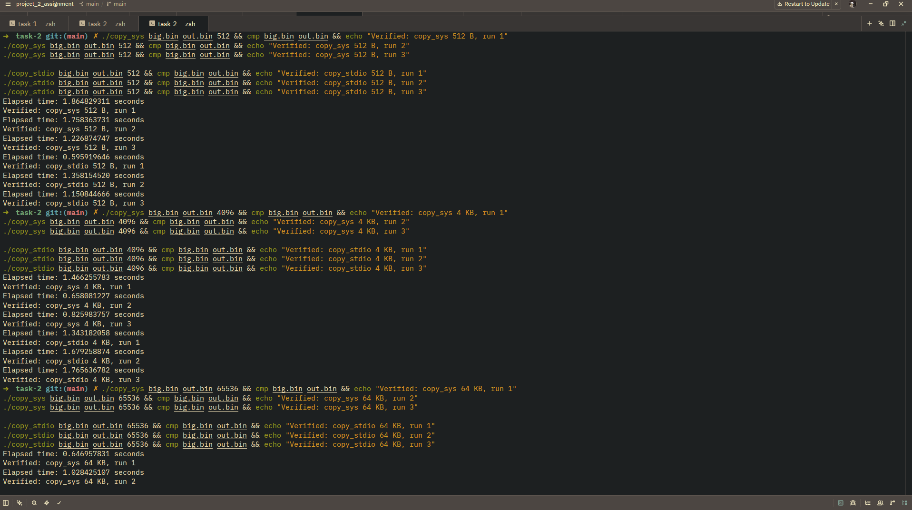
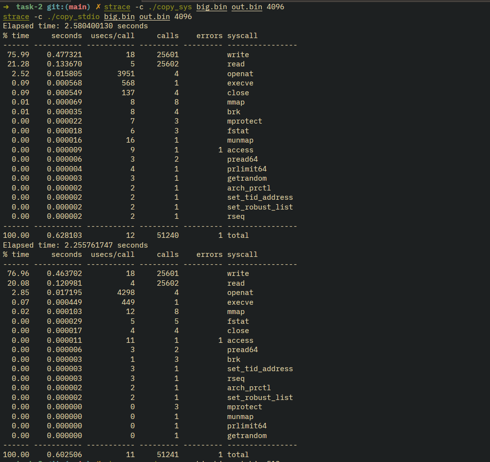
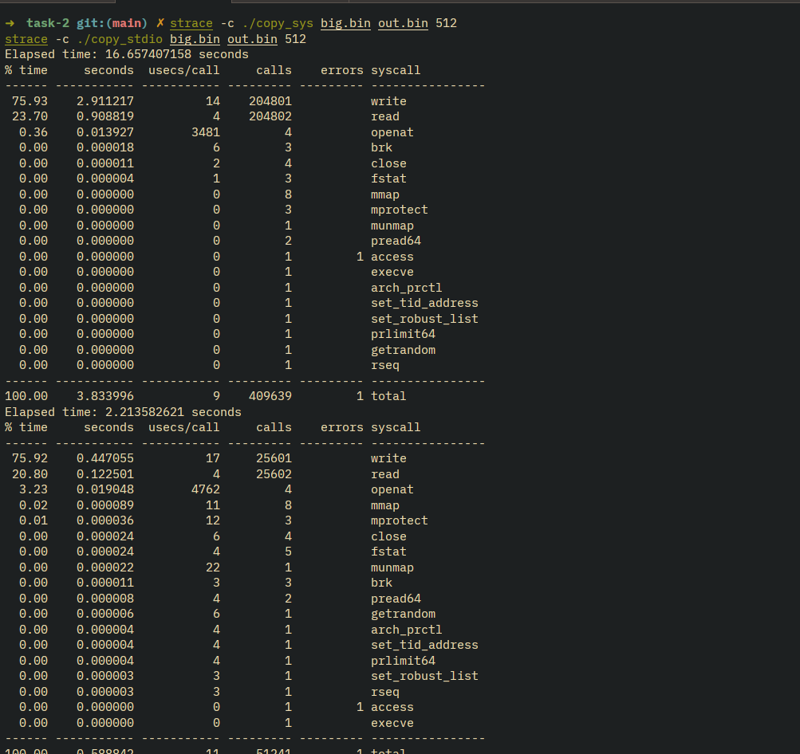
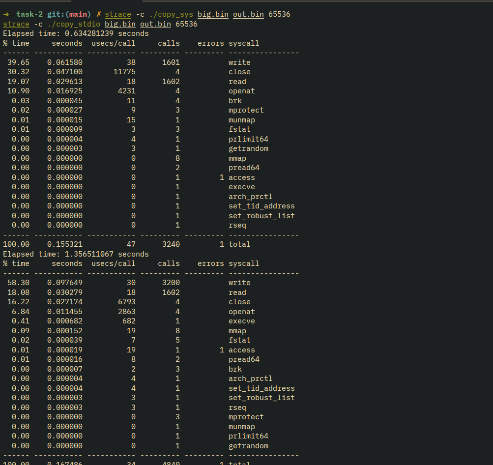

# Task 2: File-copy performance

## Method

I compared two C programs that copy a file using a buffer size supplied on the command line. `copy_sys` uses `open()`, `read()`, `write()`, and `close()`. `copy_stdio` uses `fopen()`, `fread()`, `fwrite()`, and `fclose()`.

Both programs copied the same 100 MiB input, `big.bin`, to `out.bin`. I ran each program three times at 512 B, 4 KiB, and 64 KiB without tracing. Each program measured elapsed time with `clock_gettime(CLOCK_MONOTONIC)`. All 18 copies passed the byte-for-byte `cmp` check, which ran after each timed copy.

## Elapsed time and syscall counts

The timing columns are in seconds. The `read` and `write` counts come from one separate `strace -c` run per configuration and cover the whole process.

| Program | Buffer (bytes) | Run 1 (s) | Run 2 (s) | Run 3 (s) | Mean (s) | `read` calls | `write` calls |
| --- | ---: | ---: | ---: | ---: | ---: | ---: | ---: |
| `copy_sys` | 512 | 1.864829311 | 1.758363731 | 1.226874747 | 1.616689263 | 204,802 | 204,801 |
| `copy_stdio` | 512 | 0.595919646 | 1.358154520 | 1.150844666 | 1.034972944 | 25,602 | 25,601 |
| `copy_sys` | 4096 | 1.466255783 | 0.658081227 | 0.825983757 | 0.983440256 | 25,602 | 25,601 |
| `copy_stdio` | 4096 | 1.343182058 | 1.679258874 | 1.765636782 | 1.596025905 | 25,602 | 25,601 |
| `copy_sys` | 65536 | 0.646957831 | 1.028425107 | 1.475305103 | 1.050229347 | 1,602 | 1,601 |
| `copy_stdio` | 65536 | 1.404901196 | 1.669540087 | 1.629451894 | 1.567964392 | 1,602 | 3,200 |



## 4 KiB strace comparison

```sh
strace -c ./copy_sys big.bin out.bin 4096
strace -c ./copy_stdio big.bin out.bin 4096
```

| Program | System call | Calls | Seconds | % time |
| --- | --- | ---: | ---: | ---: |
| `copy_sys` | `read` | 25,602 | 0.133670 | 21.28% |
| `copy_sys` | `write` | 25,601 | 0.477321 | 75.99% |
| `copy_stdio` | `read` | 25,602 | 0.120981 | 20.08% |
| `copy_stdio` | `write` | 25,601 | 0.463702 | 76.96% |

At 4 KiB, both programs made the same number of `read()` and `write()` calls. The stdio trace recorded slightly fewer seconds for both calls. Its `write()` percentage was slightly higher because `% time` is calculated relative to the total syscall time in each trace.

With tracing enabled, the programs printed elapsed times of 2.580 s for `copy_sys` and 2.256 s for `copy_stdio`. Both exceeded their untraced means of 0.983 s and 1.596 s. `strace` adds overhead by observing system calls. The program's elapsed time includes tracing delays and user-space work, while the `seconds` column summarizes time attributed to each syscall.



## Effect of buffer size

At 512 B, `copy_stdio` made about one-eighth as many kernel reads and writes as `copy_sys`. `fread()` can satisfy several small requests from a single internal buffer fill. `fwrite()` can collect several small requests before passing the data to the kernel. At this size, stdio averaged 1.035 s compared with 1.617 s for the direct version, a reduction of about 36%.

Each system call enters kernel mode and returns to user mode. The transition and kernel handling add overhead. Larger buffers let the direct version transfer more data per call, spreading that overhead across more bytes. Its write count fell from 204,801 at 512 B to 25,601 at 4 KiB and 1,601 at 64 KiB. The syscall-count advantage of stdio disappeared at 4 KiB. At 64 KiB, the read counts still matched, and stdio issued nearly twice as many writes. The aggregate trace gives call counts and timing, so identifying exactly how those writes were split would require a trace with individual call sizes.

The elapsed-time gap did not shrink steadily across all three sizes. Stdio led by about 0.582 s at 512 B. The direct version led by about 0.613 s at 4 KiB and 0.518 s at 64 KiB. The smaller gap from 4 KiB to 64 KiB is consistent with syscall overhead becoming less important as each call transfers more data. The variation across the three runs also shows that elapsed time depends on more than syscall counts. Page-cache state, background I/O, and scheduling can affect the results.




