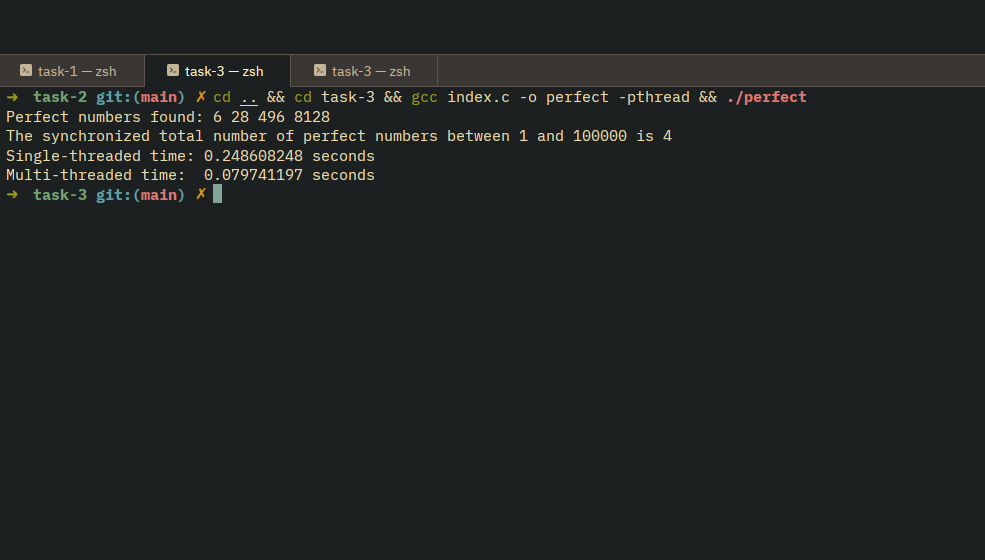

# Task 3: Perfect numbers with POSIX threads

## Search method

A perfect number equals the sum of its proper divisors. Both versions
use the same divisor check. The check starts with a sum of 1 for
numbers greater than 1. It tests divisors up to the square root and
adds both factors of each pair. For a perfect square, it adds the
square-root factor once.

The single-threaded search checks all numbers from 1 to 100,000.
The multithreaded search divides that range into eight segments of
12,500 numbers. The first thread checks 1 through 12,500 and the last
checks 87,501 through 100,000. Each thread receives its bounds through
a struct.

## Synchronization

One mutex protects the shared result array, its next available index,
and the shared total. Without the mutex, two threads could claim the
same array slot or overwrite each other's updates to the total.

Each thread counts matches locally and adds its count to the shared
total once after finishing its range. It also locks briefly each time
it appends a match. The divisor checks run outside the mutex, which
avoids acquiring a lock for every number checked.

The main thread joins all workers before sorting and printing the
results. The search found 6, 28, 496, and 8128, for a total of 4.

## Performance

| Measurement | Result |
| --- | ---: |
| Single-threaded elapsed time (s) | [time] |
| Multithreaded elapsed time (s) | [time] |
| Speedup (single-threaded time / multithreaded time) | [ratio] |

Both elapsed times were measured using `CLOCK_MONOTONIC`. The parallel
measurement includes creating and joining the threads. Sorting and
printing happen after the timed search.

[State which version was faster and by how much.]

Equal-sized segments contain the same number of candidates, but
larger candidates have higher square roots and generally require more
divisor checks. The last segments therefore do more work than the
first. The main thread must wait for the slowest worker, and thread
creation and scheduling also contribute to the measured time.

